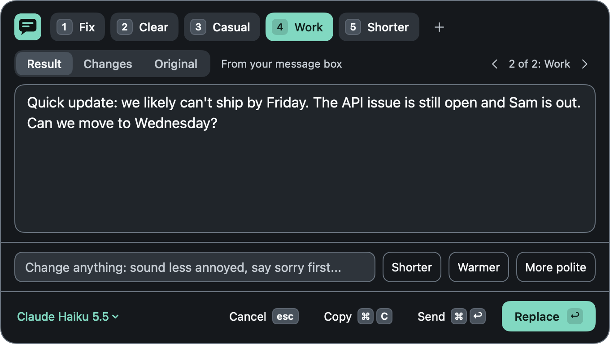
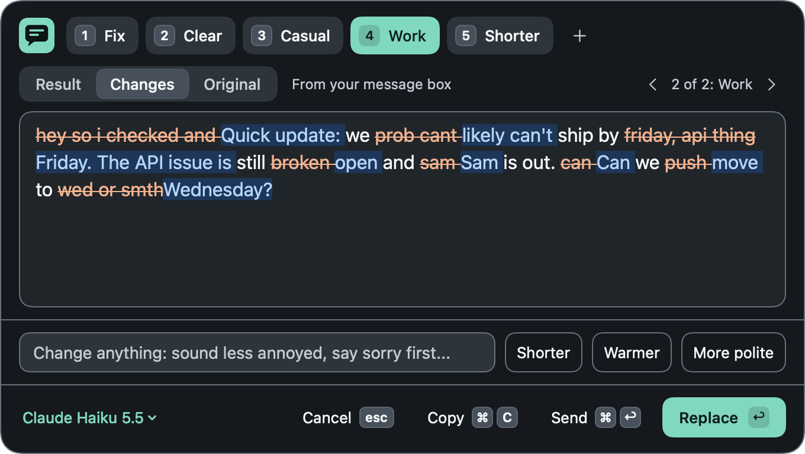
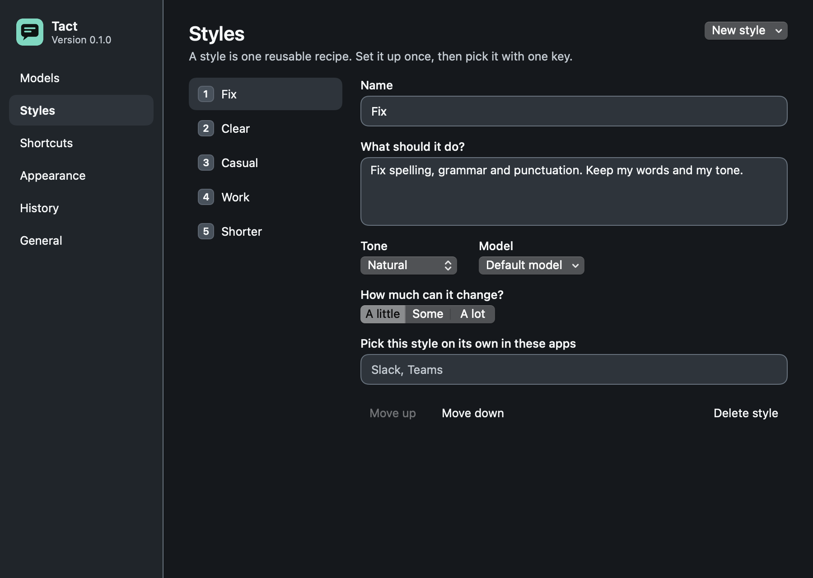
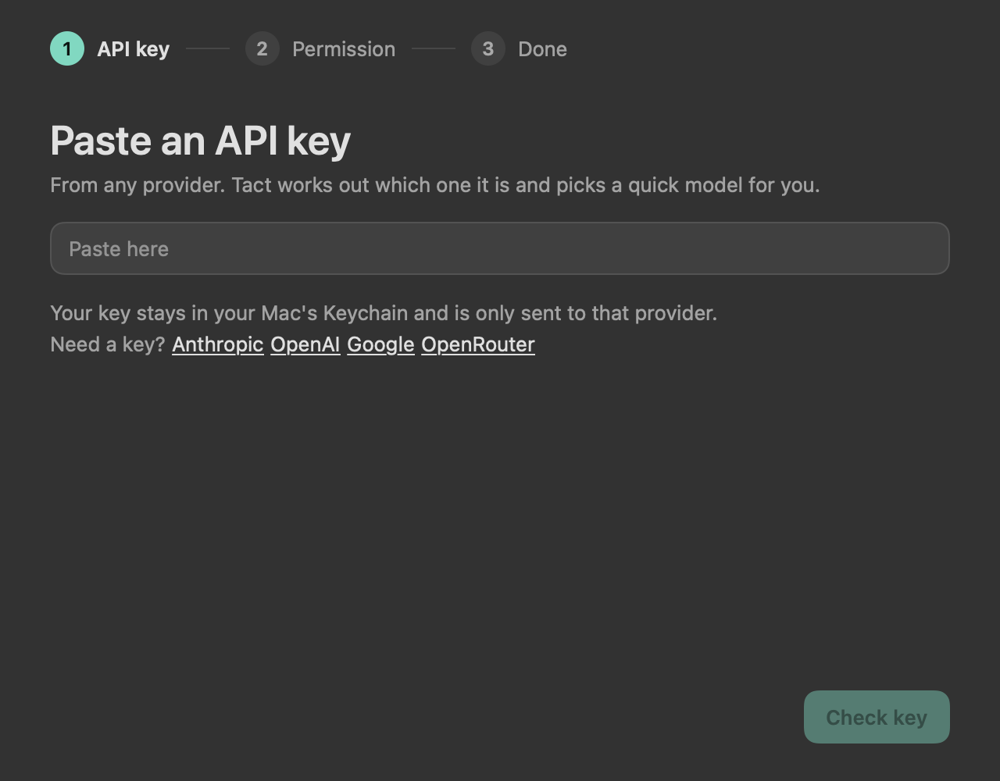
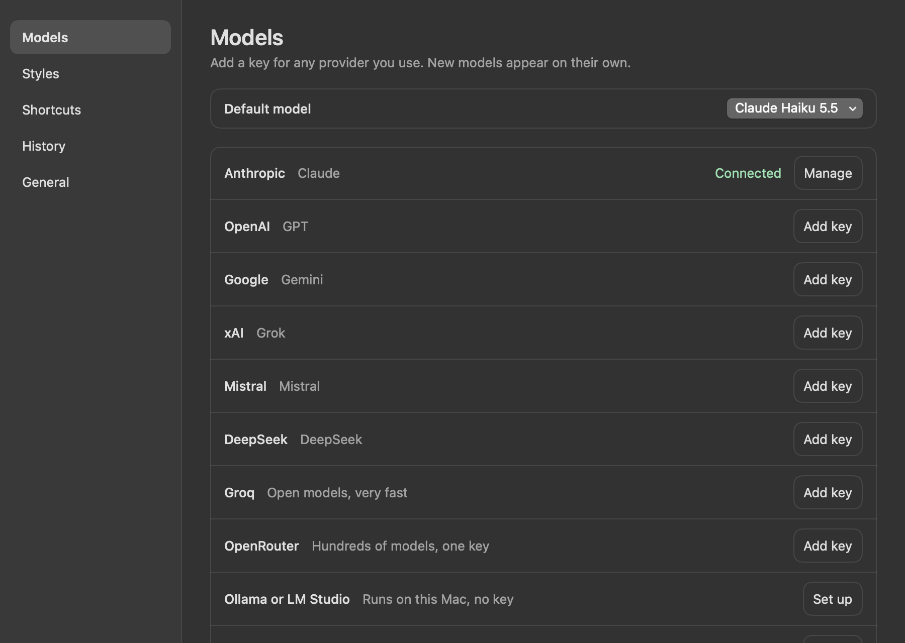

<p align="center">
  
</p>

<h1 align="center">Tact</h1>

<p align="center">
  <strong>Say it better, in any chat app.</strong><br>
  A native Mac menu bar app that rewrites your message with the AI provider of your choice.
</p>

<p align="center">
  
  
  
  
  
</p>

<p align="center">
  
</p>

Type a message, press <kbd>⌃</kbd> <kbd>⌥</kbd> <kbd>R</kbd>, and press <kbd>Return</kbd>. The rewritten message appears in the box you were typing in. There's nothing to select, no form to fill in, and no window to switch to.

## Contents

- [Features](#features)
- [Requirements](#requirements)
- [Installation](#installation)
- [Getting started](#getting-started)
- [Keyboard shortcuts](#keyboard-shortcuts)
- [Supported providers](#supported-providers)
- [Styles](#styles)
- [Privacy and security](#privacy-and-security)
- [How it works](#how-it-works)
- [Troubleshooting](#troubleshooting)
- [Project status](#project-status)
- [Development](#development)
- [Uninstalling](#uninstalling)
- [License](#license)

## Features

- **One shortcut, in any app.** Tact takes the text from your message box, or just your selection if you made one.
- **Streaming results.** The rewrite appears as it's written, in a small panel above the message box.
- **Reusable styles.** Fix, Clear, Casual, Work and Shorter come built in, each one key away. Edit them or add your own.
- **Automatic style picking.** Use Work in Slack and Casual in WhatsApp without choosing each time.
- **Quick refinements.** Type a change in plain English, or click Shorter, Warmer or More polite.
- **See what changed.** A Changes view marks every added and removed word.
- **Nothing gets lost.** Each attempt is kept as a version you can step back through.
- **Instant fix.** A second shortcut rewrites your message in place with no panel.
- **Bring your own key.** Use Anthropic, OpenAI, Google, xAI, Mistral, DeepSeek, Groq or OpenRouter, a local model, or your own server.
- **Always-current models.** Model lists come directly from each provider, so new models appear without an update.
- **Private by design.** Keys stay in your Mac's Keychain, and Tact has no server and no analytics.

<table>
  <tr>
    <td width="50%"></td>
    <td width="50%"></td>
  </tr>
  <tr>
    <td align="center"><em>See exactly what changed</em></td>
    <td align="center"><em>Set up a style once, then pick it with one key</em></td>
  </tr>
</table>

## Requirements

| Requirement | Details |
|---|---|
| macOS | 14 Sonoma or later |
| Xcode | 16 or later, free from the [Mac App Store](https://apps.apple.com/app/xcode/id497799835) |
| AI access | An API key from a [supported provider](#supported-providers), or a local model |
| Apple account | Optional and free. A paid Apple Developer account is not needed |

Tact is built from source, so there's no download to install.

## Installation

### 1. Set up Xcode

Install Xcode, open it once to accept the license, then make sure the command line tools point to it:

```bash
xcode-select -p
```

The result should be `/Applications/Xcode.app/Contents/Developer`.

### 2. Add a free Apple signing certificate (recommended)

This step lets macOS remember Tact's permissions when you rebuild it. Skip it if you're only trying Tact once.

1. Open **Xcode → Settings → Accounts**.
2. Click **+** and sign in with your Apple ID.
3. Select your team, click **Manage Certificates**, then **+ → Apple Development**.

Check that it worked:

```bash
security find-identity -v -p codesigning
```

You should see a line containing `Apple Development`.

### 3. Build and install

```bash
git clone https://github.com/xnarik/tact.git
```

```bash
cd tact
```

```bash
scripts/install.sh
```

The script builds a release version, signs it, copies it to `/Applications/Tact.app` and opens it. It closes any running copy of Tact first.

Without a certificate, the script signs the app ad-hoc and tells you so. Tact still works, but macOS will ask for its permissions again after every rebuild.

### Updating

```bash
git pull
```

```bash
scripts/install.sh
```

Your settings, styles, history and keys are kept.

## Getting started

Tact opens a short setup the first time it runs.

<p align="center">
  
</p>

1. **Paste an API key.** Tact recognises most providers from the key itself, checks it, and picks a quick model.
2. **Allow Accessibility.** Click **Open System Settings** and turn on Tact. This lets it read your message and put the new version back. If you skip this, Tact works from your clipboard and you paste the result yourself.
3. **Try it.** Open a chat app, type a message and press <kbd>⌃</kbd> <kbd>⌥</kbd> <kbd>R</kbd>.

Tact then lives in your menu bar as a speech bubble icon. To start it automatically, turn on **Settings → General → Start when I log in**.

## Keyboard shortcuts

### Anywhere on your Mac

| Shortcut | Action |
|---|---|
| <kbd>⌃</kbd> <kbd>⌥</kbd> <kbd>R</kbd> | Open the panel on your message |
| <kbd>⌃</kbd> <kbd>⌥</kbd> <kbd>F</kbd> | Instant fix, with no panel |
| <kbd>⌃</kbd> <kbd>⌥</kbd> <kbd>L</kbd> | Repeat the last style, with no panel |
| <kbd>⌃</kbd> <kbd>⌥</kbd> <kbd>H</kbd> | Open history |

You can change any of these in **Settings → Shortcuts**.

### In the panel

| Key | Action |
|---|---|
| <kbd>Return</kbd> | Replace your message |
| <kbd>⌘</kbd> <kbd>Return</kbd> | Replace and send |
| <kbd>⌘</kbd> <kbd>C</kbd> | Copy the result |
| <kbd>1</kbd> to <kbd>9</kbd> | Switch style, while the edit box is empty |
| <kbd>Tab</kbd> | Switch between Result, Changes and Original |
| <kbd>⌘</kbd> <kbd>[</kbd> and <kbd>⌘</kbd> <kbd>]</kbd> | Step through versions |
| <kbd>Esc</kbd> | Close without changing anything |

## Supported providers

Add as many as you like in **Settings → Models**, and choose a model per style if you want to.

| Provider | Models | Get a key |
|---|---|---|
| Anthropic | Claude | [console.anthropic.com](https://console.anthropic.com/settings/keys) |
| OpenAI | GPT | [platform.openai.com](https://platform.openai.com/api-keys) |
| Google | Gemini | [aistudio.google.com](https://aistudio.google.com/apikey) |
| xAI | Grok | [console.x.ai](https://console.x.ai) |
| Mistral | Mistral | [console.mistral.ai](https://console.mistral.ai/api-keys) |
| DeepSeek | DeepSeek | [platform.deepseek.com](https://platform.deepseek.com/api_keys) |
| Groq | Open models | [console.groq.com](https://console.groq.com/keys) |
| OpenRouter | Hundreds of models with one key | [openrouter.ai](https://openrouter.ai/keys) |
| Ollama or LM Studio | Whatever you run locally | No key needed |
| Custom | Any OpenAI-compatible server | Depends on your server |

You pay your provider directly for what you use. Tact adds no fees.

<p align="center">
  
</p>

## Styles

A style is a saved recipe for rewriting a message. Each one has:

- **Instructions**, in plain English
- **A tone**, from 12 options such as Professional, Friendly or Direct
- **How much it can change**: A little, Some or A lot
- **A model**, if you want one other than your default
- **Apps** where it's picked automatically

| Built-in style | What it does | Picked automatically in |
|---|---|---|
| Fix | Corrects spelling, grammar and punctuation, and keeps your words | |
| Clear | Makes the point easy to understand at a glance | |
| Casual | Keeps it relaxed, like texting a friend | WhatsApp, Telegram, Messages |
| Work | Sounds professional but still like a chat message | Slack, Teams |
| Shorter | Cuts it to the fewest words that keep every fact | |

**Settings → Styles → New style** also offers 16 templates, including Email, Follow-up, Sensitive message, Meeting summary and Customer support.

## Privacy and security

| What | Where it goes |
|---|---|
| Your message | Sent over HTTPS straight from your Mac to the provider you picked, and only when you press a shortcut. Local models stay on your Mac |
| API keys | Stored in your macOS Keychain, and sent only to that provider |
| Settings and styles | `~/Library/Application Support/Tact/settings.json` |
| History | `~/Library/Application Support/Tact/history.json`, kept for 30 days by default |

- Tact has no server, account, analytics or tracking.
- History files can be read only by your Mac user, but they aren't encrypted. To stop saving messages, choose **Don't save** in **Settings → History**.
- Accessibility access is powerful, so it's used only when you press a Tact shortcut.
- A key whose provider can't be recognised is never sent anywhere by guesswork. Tact asks you which provider it belongs to.
- Keys starting with `sk-` could be OpenAI or DeepSeek. Tact tries OpenAI first, and sends the key to DeepSeek only if OpenAI rejects it.
- While replacing text, Tact briefly uses your clipboard, then restores it. It marks that text so that clipboard managers skip it.
- Each provider's own privacy terms apply to what you send them.

## How it works

1. You press the shortcut.
2. Tact reads your message box.
3. The panel opens above the box, and the rewrite streams in.
4. You press Return to replace your text, type a change to try again, or press Esc to close with nothing changed.

**Reading your message.** Tact asks macOS Accessibility for the selected text, then for the contents of the message box. Web-based chat apps often hide their text from Accessibility, so Tact falls back to copying it, then uses your clipboard if that fails.

**Replacing your message.** Tact pastes the result, because pasting works everywhere, including web-based apps that ignore direct text changes.

**Talking to providers.** Three small clients cover every provider: Anthropic, Google, and one for OpenAI-compatible services. Tact doesn't send sampling settings such as temperature, because current models from several providers reject them. Creativity is set in the prompt instead.

**Protecting your draft.** The prompt tells the model to treat your draft only as text to rewrite. A message that reads like a question gets rewritten, not answered.

### Project layout

| Path | Contents |
|---|---|
| `Sources/TactKit/Core` | Providers, streaming, prompts, styles and storage |
| `Sources/TactKit/Mac` | Global shortcuts, reading and replacing text, app lifecycle |
| `Sources/TactKit/UI` | The panel, setup and Settings |
| `Sources/Tact` | The app entry point |
| `Sources/TactSnapshots` | Draws every screen and the app icon to PNG files |
| `Tests/TactKitTests` | Unit tests, which need no network or API key |
| `scripts/install.sh` | Builds, signs and installs the app |

## Troubleshooting

<details>
<summary><strong>The shortcut does nothing</strong></summary>

Another app may already use that shortcut. Open **Settings → Shortcuts**, click the shortcut and choose a different one. Tact tells you if it can't claim a shortcut you pick.
</details>

<details>
<summary><strong>I can't see the menu bar icon</strong></summary>

On a Mac with a notch, icons can be hidden behind it when the menu bar is full, so try quitting another menu bar app. Also check the menu bar settings in **System Settings**, in case Tact needs to be allowed there.
</details>

<details>
<summary><strong>Tact says it's using the clipboard, or the Replace button says Copy</strong></summary>

Tact doesn't have Accessibility access, or it couldn't read the message box. Check **System Settings → Privacy & Security → Accessibility** and make sure Tact is on.
</details>

<details>
<summary><strong>Accessibility is on, but Tact still can't reach my message</strong></summary>

macOS may be holding an old permission from an earlier build. Remove Tact from the Accessibility list with the **−** button, then add `/Applications/Tact.app` again. Adding a signing certificate ([step 2](#2-add-a-free-apple-signing-certificate-recommended)) prevents this.
</details>

<details>
<summary><strong>macOS keeps asking for Keychain access</strong></summary>

This happens when the app's signature changes between builds. Add a signing certificate, reinstall, then choose **Always Allow** once.
</details>

<details>
<summary><strong>Send adds a new line instead of sending</strong></summary>

Send presses Return in your chat app, and some apps use Return for a new line. Turn the button off in **Settings → General**, or change the app's own setting.
</details>

<details>
<summary><strong>Provider or model errors</strong></summary>

Open **Settings → Models**, choose **Manage** on the provider, then **Refresh models**. If your key was rejected, remove it and add it again. For a local server, check that it's running and that the address is correct.
</details>

## Project status

Tact is an early release, version 0.1.0.

| Area | Status |
|---|---|
| Build and install | Tested on macOS 27 with Xcode 27, Apple silicon |
| Prompts, streaming parsers, storage | Covered by 20 automated tests |
| Provider addresses and key rejection | Checked against live services, except DeepSeek, which couldn't be reached from the test network |
| Full rewrites with a real API key | Not yet tested |
| Reading and replacing text in chat apps | Not yet tested in real chat apps |

Earlier macOS versions and Intel Macs haven't been tested.

**Known limitations**

- Style switching takes number keys while the edit box is empty, so an instruction can't begin with a number that matches a style.
- Synthetic keystrokes assume a standard key layout, so select-all, copy and paste may misbehave on some non-QWERTY layouts.
- Messages over 20,000 characters aren't read automatically.

## Development

Run the tests:

```bash
swift test
```

Draw every screen to PNG files, in light and dark mode:

```bash
swift run TactSnapshots screens build/screens
```

## Uninstalling

1. Click the menu bar icon and choose **Quit Tact**.
2. Delete the app and its data:

```bash
rm -rf /Applications/Tact.app ~/Library/Application\ Support/Tact
```

3. Remove your keys. In **Keychain Access**, search for `com.kirants.tact.apikeys` and delete the entries. To remove them from **Settings → Models** instead, do that before step 1.
4. Remove Tact from **System Settings → Privacy & Security → Accessibility**.

## License

Tact is released under the [MIT License](LICENSE).
